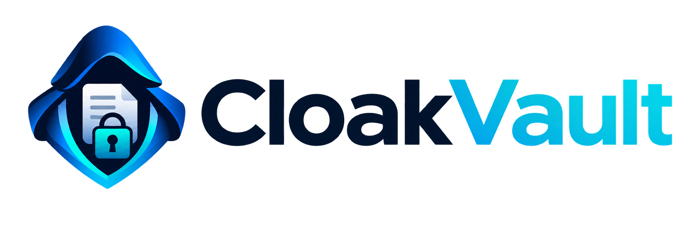
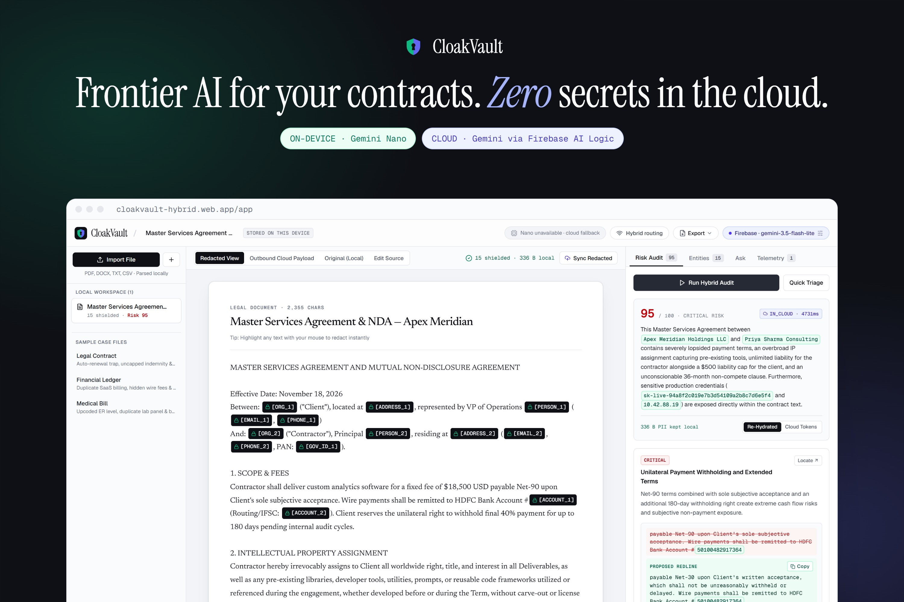
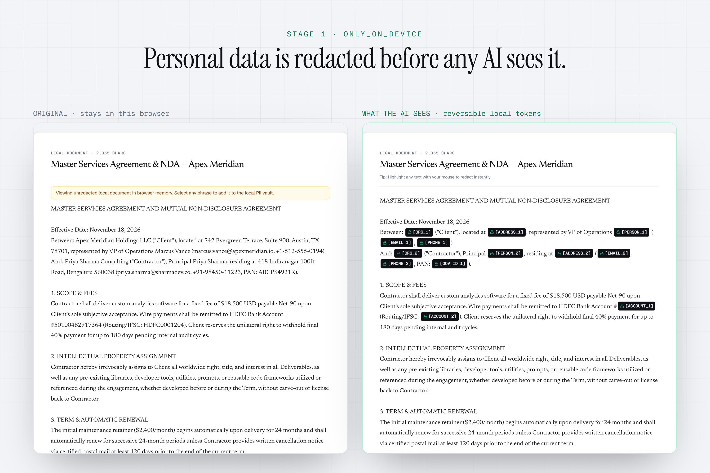
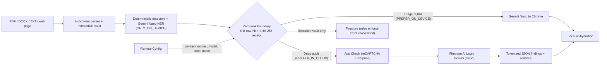
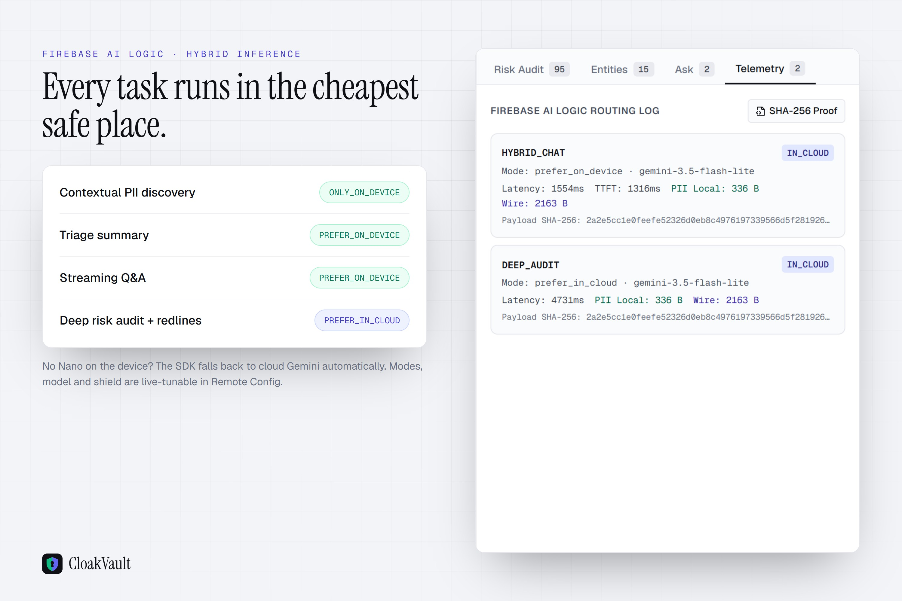
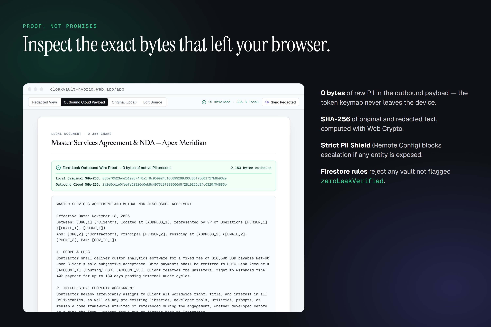
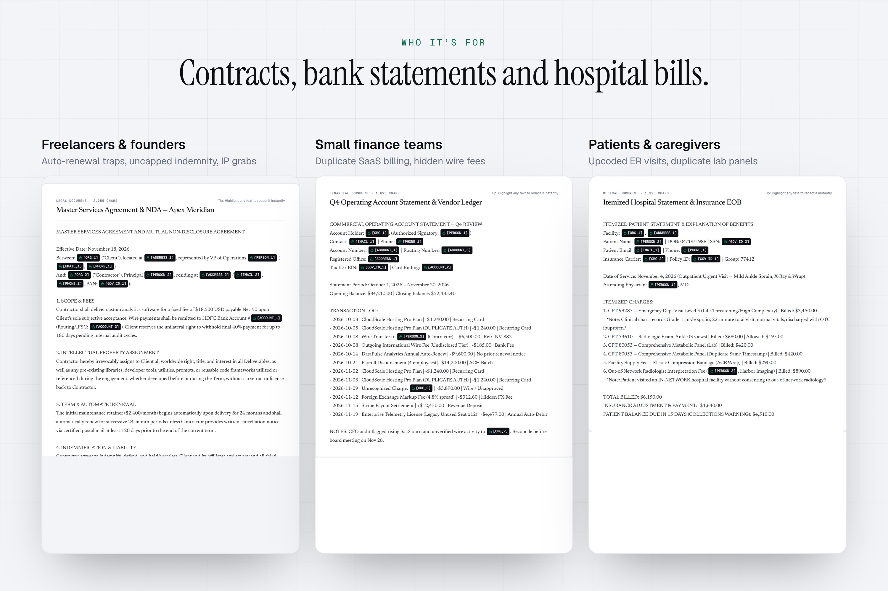

<div align="center">



### Frontier AI for your contracts. Zero secrets in the cloud.

**Zero-leak hybrid AI document intelligence — built on Firebase AI Logic hybrid inference.**

[**▶ Try it live**](https://cloakvault.buzz) · [**Open the workbench**](https://cloakvault.buzz/app) · [Demo video](#demo-video) · [How it works](#how-it-works) · [Firebase usage](#how-cloakvault-uses-firebase-ai-logic)

`#BuildHybridAI 2026` · Platform: **Web (Chrome)** · License: **Apache-2.0**

</div>



## The problem

The documents that most need a second opinion — an NDA, a bank statement, an itemized hospital bill — are exactly the ones you shouldn't paste into a chatbot. They're full of names, government IDs, account numbers and addresses. So freelancers sign the uncapped-indemnity clause, patients pay the duplicate lab charge, and small finance teams miss the double SaaS bill.

## The solution

**CloakVault** is a document workbench that gives you a frontier-model risk audit **without ever sending raw personal data to the cloud**:

1. **Shield on-device** — files are parsed in the browser; deterministic detectors plus **Gemini Nano** swap every name, ID, account and address for a reversible local token (`[PERSON_1]`, `[ACCOUNT_1]`…).
2. **Triage & chat locally** — summaries and streaming Q&A **prefer on-device Gemini Nano** (free, private, offline-capable) and fall back to cloud Gemini automatically when Nano isn't available.
3. **Escalate only tokens** — the deep clause-by-clause audit **prefers the cloud**, but only the verified, tokenized payload is sent. Findings come back with exact clause quotes and ready-to-send redlines, and are **re-hydrated locally**.
4. **Prove it** — the *Outbound Cloud Payload* view shows the exact bytes sent plus Web Crypto **SHA-256** hashes; export a JSON zero-leak certificate.



## Judges: 60-second test

1. Open **https://cloakvault.buzz** → **Open the workbench** (no sign-up; a sample contract is preloaded).
2. Toggle **Original (Local)** ⇄ **Redacted View** — 15 entities are tokenized on-device. Highlight any text to redact more.
3. Click **Run Hybrid Audit** → a risk score, clause findings and redlines in ~5–10 s (`IN_CLOUD`, via Firebase AI Logic + App Check).
4. Click **Locate ↗** on a finding, then flip **Re-Hydrated ⇄ Cloud Tokens** to see what the cloud actually saw.
5. Open **Outbound Cloud Payload** to verify zero raw PII and the SHA-256 receipt; check **Telemetry** for real `inferenceSource`, latency and TTFT.
6. Toggle **Hybrid routing → Air-gap** to lock every task to on-device. In Chrome with built-in AI, click **Download Gemini Nano** and everything keeps working offline.

> On a browser without Gemini Nano, the header shows *“Nano unavailable · cloud fallback”* — that's the hybrid SDK doing its job. Redaction is always 100% local.

## How it works



### How CloakVault uses Firebase AI Logic

Every AI task gets its own `getGenerativeModel()` with a deliberately chosen `InferenceMode`, and the app records the real `response.inferenceSource` for each call:

| Task | `InferenceMode` | Why | Code |
|---|---|---|---|
| Contextual PII discovery | `ONLY_ON_DEVICE` | Raw text must never leave the device — no cloud fallback by design | [`discoverContextualPiiOnDevice`](src/lib/hybridAiService.ts) |
| Triage summary | `PREFER_ON_DEVICE` | Fast, free, private; cloud only if Nano is missing | [`runHybridTriage`](src/lib/hybridAiService.ts) |
| Streaming document Q&A | `PREFER_ON_DEVICE` (user-switchable) | `generateContentStream` with real TTFT telemetry | [`streamHybridChatTurn`](src/lib/hybridAiService.ts) |
| Deep risk audit + redlines | `PREFER_IN_CLOUD` | Needs frontier reasoning over ~12k chars; falls back to Nano offline | [`runHybridDeepAudit`](src/lib/hybridAiService.ts) |
| Air-gap mode | forces `ONLY_ON_DEVICE` | Offline-first; refuses rather than leaks | [`executeHybridInference`](src/lib/hybridAiService.ts) |

```ts
// src/lib/firebaseClient.ts
const ai = getAI(app, { backend: new GoogleAIBackend() });

// src/lib/hybridAiService.ts
const model = getGenerativeModel(ai, {
  mode: InferenceMode.PREFER_IN_CLOUD,           // per task, overridable via Remote Config
  inCloudParams: { model: 'gemini-4-hydrogen', systemInstruction, generationConfig },
  onDeviceParams: { createOptions: { expectedOutputs: [{ type: 'text', languages: ['en'] }] } },
});
const result = await model.generateContent(tokenizedPrompt);
result.response.inferenceSource; // ON_DEVICE | IN_CLOUD → shown in the UI + telemetry
```



### Firebase products used

| Product | Role | Code |
|---|---|---|
| **Firebase AI Logic** (`firebase/ai`) | Hybrid on-device/cloud inference, streaming, `inferenceSource` telemetry | `src/lib/hybridAiService.ts`, `src/lib/firebaseClient.ts` |
| **App Check** | `ReCaptchaEnterpriseProvider` on every AI request (debug token in local dev only) | `src/lib/firebaseClient.ts` |
| **Remote Config** | Live policy: `default_qa_inference_mode`, `deep_audit_inference_mode`, `cloud_model_name`, `strict_pii_shield`, `max_local_context_chars` | `src/lib/firebaseClient.ts` |
| **Cloud Firestore** | Redacted vaults + telemetry only; [rules](firestore.rules) require `zeroLeakVerified == true` and an allowlisted field set | `src/lib/firestoreVault.ts` |
| **Authentication** | Invisible anonymous guest for sync, optional Google sign-in — no sign-up wall | `src/lib/firebaseClient.ts` |
| **Hosting** | https://cloakvault.buzz | `firebase.json` |



## Features

- **Local parsing** of PDF (`pdfjs-dist`), DOCX (`mammoth`), TXT, MD and CSV — nothing uploaded
- **Hybrid PII shield**: deterministic detectors + Gemini Nano NER + **select-to-redact**
- **Risk audit**: 0–100 score, severity-ranked findings, exact clause quotes with **Locate ↗**, strikethrough + proposed redlines, missing-protection checklist
- **X-ray toggle**: re-hydrated view ⇄ the tokens the cloud actually saw
- **Streaming Q&A** with on-device / cloud selector, TTFT and latency per answer
- **Outbound payload inspector** + SHA-256 receipts; **Strict PII Shield** blocks escalation if anything is exposed
- **Air-gap mode** for fully on-device operation
- **Exports (100% client-side, offline-safe)**: redacted `.pdf`, `.docx`, `.txt`, and `.html`; redlined audit `.pdf`, `.docx`, and `.md`; shielded entities & findings `.csv`; JSON zero-leak SHA-256 certificate
- **Works on phones & tablets (Android / iOS)**: mobile tab layout, touch select-to-redact, installable **PWA** with an offline app shell (no AI calls or documents are cached)
- **Chrome side-panel extension** (`chrome-extension/`) — scan any web page's terms locally, hand off to the workbench
- Three realistic sample case files: freelance MSA/NDA, SaaS ledger, itemized hospital bill + EOB



## Demo video

📺 **YouTube:** _link added on submission_ — under 3 minutes, English narration + English subtitles, illustrated chapters and original sound design.

The video is generated reproducibly from the real app (live Firebase AI Logic calls) — see [`marketing/`](marketing/README.md).

## Run it locally

```bash
npm install
cp .env.example .env.local     # add your Firebase web config (or paste it in the in-app “Firebase” panel)
npm run dev                     # http://localhost:5173  (landing)  ·  /app (workbench)
```

Firebase console setup: enable **Firebase AI Logic** (Gemini Developer API), **App Check** with reCAPTCHA Enterprise (register a debug token for localhost), **Remote Config**, **Firestore** (`firebase deploy --only firestore:rules`), and **Anonymous** + **Google** sign-in.

### Enable Gemini Nano (on-device) in Chrome
1. Use Chrome desktop with the built-in Prompt API (see [Chrome built-in AI](https://developer.chrome.com/docs/ai/built-in)).
2. In the workbench header click **Download Gemini Nano**; the pill turns green: *Gemini Nano · on-device*.
3. Toggle **Air-gap** (or go offline) to watch every task run locally.

### Chrome side-panel extension
`chrome://extensions` → Developer mode → **Load unpacked** → select `chrome-extension/`. Open any Terms of Service page, scan & redact locally, then **Send to CloakVault Web App**.

### Tests & build

```bash
npm test          # Vitest — zero-leak redaction & re-hydration
npm run typecheck
npm run build
```

## Project structure

```
src/
  components/Landing.tsx        landing page (/)
  App.tsx                       workbench (/app)
  lib/hybridAiService.ts        Firebase AI Logic hybrid inference (all AI calls)
  lib/firebaseClient.ts         App, AI Logic, App Check, Remote Config, Auth, Firestore init
  lib/piiEngine.ts              deterministic detectors, tokenization, re-hydration
  lib/cryptoProof.ts            SHA-256 receipts + exports
chrome-extension/               side-panel extension
marketing/                      reproducible demo video + gallery pipeline
firestore.rules                 zero-leak enforced rules
```

## License

[Apache-2.0](LICENSE)
